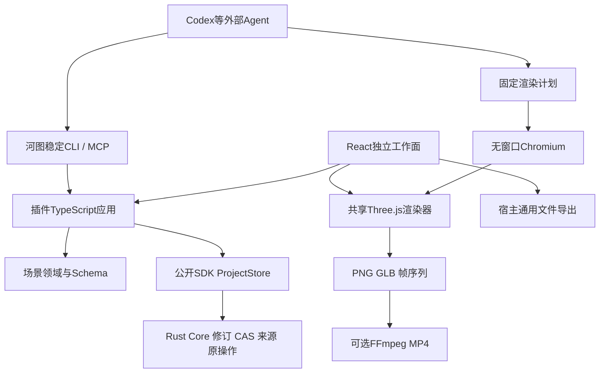

> 本文属于[导演布景台文档](README.md)。

# 总体架构与技术选型

## 分层与选型

| 层 | 技术 | 原因与边界 |
| --- | --- | --- |
| 专业领域 | TypeScript、Ajv | 相同Schema约束GUI与机器；构建期生成静态校验器，不放宽宿主CSP或运行eval；不依赖Electron／Cordis |
| 三维 | Three.js、OrbitControls、TransformControls、GLTFExporter | 成熟WebGL场景、交互控件和通用GLB；程序几何无需外部素材下载 |
| 工作面 | React、共享Radix语义变量 | 独立全幅画布，继承宿主浅暗外观 |
| 插件适配 | 公开SDK、ProjectStore | 复用作品、固定来源、CAS、修订及原操作 |
| 离线渲染 | Node.js内置HTTP／WebSocket、Chromium CDP | 不要求启动河图GUI，不重复实现绘制；本地端口与临时浏览器退出清理 |
| 媒体编码 | 外部FFmpeg | PNG序列为基础交付，MP4作为明确参数；不声称白模等于最终画面 |

Cordis仅由宿主管生命周期，本插件不依赖其内部服务。Rust不参与三维组件注册与渲染，不将白模类型扩为宿主核心领域。

## 调研来源

2026-11-17以[Three.js官方文档](https://threejs.org/docs/)、[TransformControls](https://threejs.org/docs/#TransformControls)、[GLTFExporter](https://threejs.org/docs/#GLTFExporter)、[Chrome DevTools Protocol](https://chromedevtools.github.io/devtools-protocol/)及本机公开SDK为依据。DSH／Pi的贡献与生命周期参考沿用宿主插件27；采用其扩展思路，不复制Agent架构。参考图用于功能与布局对照，三维资产由本项目程序生成。
