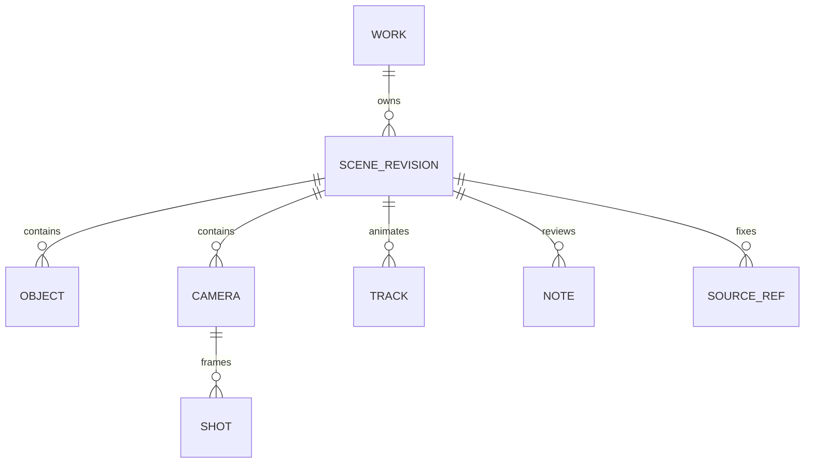

> 本文属于[导演布景台文档](README.md)。

# 领域模型与数据合同

## 核心本体与单位

Scene是当前作品的专业对象，包含Object、Camera、Track、Shot、Environment与ReviewNote。Object代表白模占位，不等于正式人物或最终资产；可通过source_index指向宿主固定来源。Camera是一台机位，Shot指时间线区间使用哪台机位。Track对一个Object或Camera的属性执行关键帧插值。

采用米、右手坐标、Y向上；位置与缩放为三元数组，Euler旋转以度保存、XYZ顺序转换。时间线使用整数帧和整数FPS，区间为[start,end)，不使用浮点毫秒作为身份。关键帧按frame严格递增，render仅覆盖0到duration_frames-1。

## 存储与事务

不新增插件数据库。Core现有受管对象表保存kind=`director_stage_scene`、schema_version、JSON内容、来源、修订和摘要；操作记录由Core持有。对象／机位／轨道是单个场景修订内的值，单动作最多一次权威保存。单场景512KiB、最多200个对象、24个机位、200轨道、1000关键帧／轨、200镜头、100来源。引用及数值越界拒绝，标题不作为ID。

每次写入固定expected_revision、expected_sha256、operation_key。已有固定来源只能追加，不能重定向旧索引。来源、正文与素材仍由Core核验。删除对象同时移除其轨道；删除被Shot或轨道使用的Camera时拒绝，要求先修改引用。

## JSON格式

字段事实源为`contracts/plugin-manifest.json`的数据Schema，[完整示例](examples/scene.json)与[导出Schema](examples/director-stage-scene.schema.json)由构建生成。导出包保留project_ref、work_ref、source_refs、content及render计划摘要。导入验证格式和语义，不自动携带外部工作区权限。
