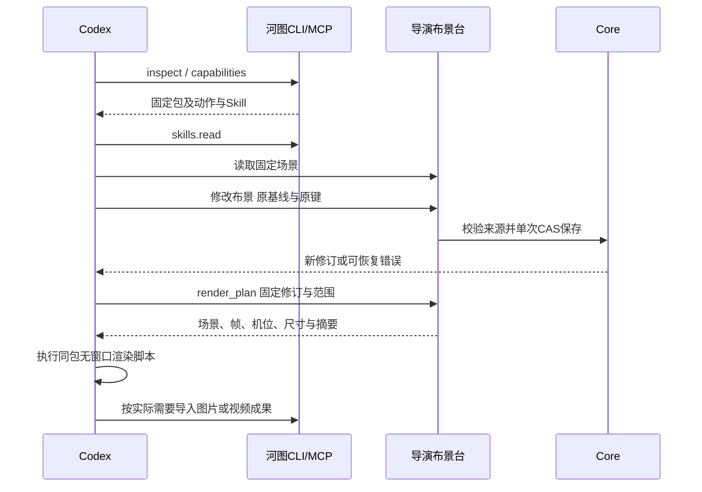

> 本文属于[导演布景台文档](README.md)。

# API与Agent协作合同

## 稳定入口

先发现宿主与活动包，再按精确作品和包摘要调用`hetu.plugins.capabilities/invoke`；完整动作参数以运行时Schema为准，动作清单由`CAPABILITIES.md`导航。接口不依赖GUI、当前选中对象或Codex原生Skill注册。

## 操作与错误

读：查找、固定读取、比较、检查、导出、渲染计划与交接。写：创建／保存、对象编辑、机位与轨道、环境、时间线、镜头、工作意见和备选。`get_operation`先于未知重发，幂等冲突不换键重试。

Schema错误、空选择、孤儿引用、重复ID、非法机位、重叠镜头、负比例、非有限数、预算超出、跨作品来源、CAS冲突均返回明确错误。已知未执行可用原输入原键继续；已执行直接回读结果；无法确认时保留原计划。

宿主`save_artifact`只在文件对话框明确选择后将有限字节原子保存，不写作品，不授予路径读取权。机器渲染通过外部Agent本机脚本写已选目录，成果登记复用公开素材导入合同。

渲染计划同时固定插件版本及实际 render.js／render.html 的 SHA-256。脚本核验同包字节后再运行，拒绝以新版渲染器解释旧计划；输出清单保留这些字段。
