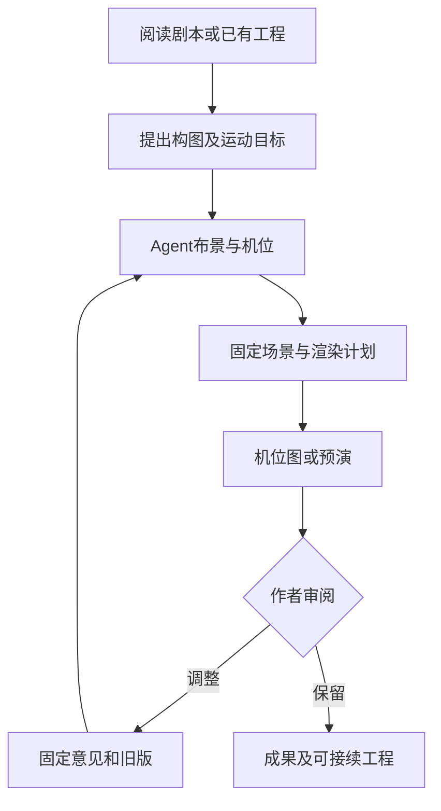

> 本文属于[导演布景台文档](README.md)。

# 用户故事与业务流程

## 用户用例

| 编号 | 起点与目标 | 成果及验收 |
| --- | --- | --- |
| DS-01 | 空视频项目，Agent建立候车亭 | 已保存场景、两个人及家具；CLI回读 |
| DS-02 | 剧本某场空间不清晰 | 固定剧本来源，布景不修改正文 |
| DS-03 | 作者调整人物站位 | 直接拖动／属性编辑／撤销重做，恢复稿与修订可读 |
| DS-04 | 两个机位对照 | 机位图、画幅与GLB中的Camera对应 |
| DS-05 | 人物从桌边走向门口 | 关键帧及镜头区间，预演帧序列／MP4 |
| DS-06 | 修改构图和节奏 | 固定旧成果意见、新修订，旧版可回读 |
| DS-07 | 导入已有场景 | 校验JSON、来源及预算，拒绝坏引用 |
| DS-08 | 本地修改期间Agent更新 | CAS拒绝，三方比较，显式选择后继续 |
| DS-09 | 保存回执丢失 | 原键查询，未重复创建或写入 |
| DS-10 | 插件停用卸载与重装 | 当前连接失效、数据保留、重新发现可读 |
| DS-11 | 仅CLI/MCP无窗口 | 建场景、改机位、固定计划、真实渲染与回读 |
| DS-12 | WebGL或浏览器不可用 | 明确失败，场景仍可读取导出，不用空白图冒充成功 |
| DS-13 | 取消保存／导出／离开 | 保留稿件与原文件，返回恢复后状态一致 |
| DS-14 | 大场景或非法数值 | 清晰预算错误，无部分权威写入 |

人物／场景来源使用精确ID和修订，不按同名推断。意见保留origin，Agent自查不能冒充作者评价。下游视频制作通过当前作品固定素材与专业工程来源接续，不为跨插件读取授予整库权限。
